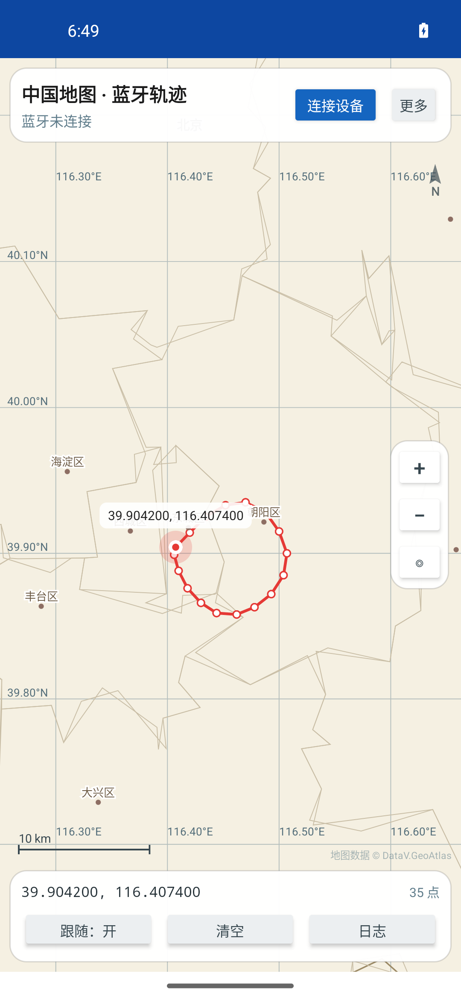
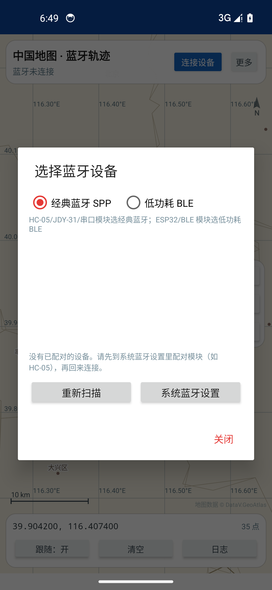

# 中国地图蓝牙轨迹（china-bt-map）

一个**完全离线**的 Android App：内置中国地图数据，通过蓝牙（经典 SPP / BLE）接收经纬度文本，在地图上实时打点、连成轨迹。
APK 里没有网络权限，不请求任何地图瓦片，装上就能用。

- 安装包：`dist/china-bt-map-1.0.apk`（约 577 KB，已签名）
- 包名：`com.btmap.china`，最低 Android 7.0（API 24），targetSdk 34
- 纯 Java + Framework API，无 AndroidX / GMS / native 库依赖

---

## 一、安装

把 `dist/china-bt-map-1.0.apk` 传到手机（微信/QQ 文件传输、数据线、网盘均可），点击安装；
系统提示“未知来源”时允许一次即可。或用 adb：

```bash
adb install -r dist/china-bt-map-1.0.apk
```

> 自签名证书仅用于个人侧载，不能上架应用商店。升级时请用同一个 `keystore/release.jks`
> （密码见下文“重新构建”），否则需要先卸载旧版。

## 二、使用

1. 给蓝牙模块（HC-05 / JDY-31 / ESP32 / BLE 串口模块等）上电。
2. 打开 App → 右上角 **连接设备** → 选择模式：
   - **经典蓝牙 SPP**：HC-05、JDY-31、串口透传模块。需要先在系统蓝牙设置里配对。
   - **低功耗 BLE**：ESP32 / BLE 串口模块 / 手环类。点“重新扫描”，选带 RSSI 的设备。
3. 连接成功后，模块每发一行坐标，地图上就会出现红点，并连成红色轨迹。
4. 手势与按钮：
   - 单指拖动、双指缩放、双击放大；
   - 右下 `+` / `−` 缩放，`◎` 回到全国视图；
   - **长按地图**任意位置，可查看并复制该点经纬度；
   - 底部 **跟随**：开着时新坐标自动居中；**清空** 删除本次轨迹；**日志** 显示原始数据与解析结果。

## 三、界面截图（Android 14 模拟器实测）

| 主界面（示例轨迹自动取景） | 双击放大 | 设备选择 |
| --- | --- | --- |
|  |  |  |

> 截图来自 1080×2340、440dpi 的 Android 14 模拟器；模拟器是软件渲染，帧率不代表真机。

## 四、坐标数据格式（一行一个点，换行分隔）

| 写法 | 示例 |
| --- | --- |
| 逗号（最常见） | `31.2304,121.4737` |
| 逗号 + 高度 | `31.2304,121.4737,12.5` |
| 空格分隔 | `31.2304 121.4737 12.5` |
| 带键名 | `lat:31.2304 lon:121.4737` |
| JSON | `{"lat":31.2304,"lng":121.4737,"alt":8.5}` |
| 半球后缀 | `31.2304N,121.4737E` |
| NMEA（GPS 模块常用） | `$GPGGA,123519,3113.824,N,12128.422,E,1,08,0.9,545.4,M,...` |
| NMEA RMC / GLL | `$GPRMC,...` / `$GPGLL,...` |

规则：

- 纯数字时按 **纬度,经度** 解析；如果第一个数超出 ±90 或明显更像经度（中国经度 73–136），会自动交换成“经度,纬度”。
- 支持半包/粘包（按字节流拼行），非法行会显示在日志里但不影响后续。
- `0,0`、超出 ±90/±180 的坐标会被丢弃；连续重复（<0.5 m）的点会去重。
- 轨迹保存在内存里，退出 App 后清空；上限 5 万点，超出后丢弃最早的 10%。

## 五、坐标转换：GCJ-02 说明

内置地图边界来自国内地图数据（阿里云 DataV.GeoAtlas），基准为 **GCJ-02（火星坐标）**；
而手机/模块的原始 GPS 多为 **WGS-84**，两者在国内相差约 300–600 米。

默认 **不转换**，保持与设备输出一致。如果发现轨迹整体偏移：

**更多 → 坐标转换 → WGS84 → GCJ-02**（反之亦然）。设置会记住，只影响之后收到的点。

## 六、地图数据

- 来源：[阿里云 DataV.GeoAtlas](https://datav.aliyun.com/portal/school/atlas/area_selector)（省级边界 34 个 + 地级市/区县边界 475 个 + 南海诸岛九段线）。
- 打包后 `app/src/main/assets/china_map.bin` 约 0.71 MB，含经纬度抽稀，加载时投影为墨卡托坐标。
- **不申请 INTERNET 权限**，安装后断网/飞行模式也能正常显示。

重新生成（会联网下载数据快照）：

```bash
python3 tools/fetch_geojson.py     # 下载 tools/geojson/*.json（已入库，可跳过）
python3 tools/pack_map.py          # 生成 china_map.bin + docs/preview/china_map.png
python3 tools/pack_map.py --verify # 只校验资产
```

## 七、自己重新构建

只需要 macOS（Apple Silicon）+ 网络，工具链全部装在工程内的 `toolchain/`，不污染系统：

```bash
./setup.sh --emulator   # JDK17 + Android SDK 34 + 模拟器镜像，一次性（约 2GB）
./build.sh              # 产出 dist/china-bt-map-1.0.apk

./tests/run_tests.sh    # 纯 JVM 单测（47 项）
./verify_emulator.sh    # 无窗口模拟器安装 + 注入坐标 + 截图（KEEP=1 保留模拟器）
```

构建不依赖 Gradle：`aapt2 → javac → d8 → zipalign → apksigner`。

- 签名证书：`keystore/release.jks`，alias `chinamap`，store/key 密码均为 `chinamap123`。
- 改版本号：`build.sh` 顶部 `VERSION_CODE` / `VERSION_NAME`。

## 八、项目结构

```
app/src/main/
  AndroidManifest.xml             权限（只有蓝牙，没有网络）
  assets/china_map.bin            内置地图数据
  res/layout/activity_main.xml    主界面（地图 + 状态条 + 底部操作）
  res/layout/dialog_devices.xml   设备选择对话框
  java/com/btmap/china/
    MainActivity.java             界面、权限、演示/测试入口
    map/ChinaMapView.java         自绘地图：省/市界、经纬网、轨迹、比例尺
    map/MapData.java              读取二进制地图资产
    map/Mercator.java             Web 墨卡托投影
    track/CoordParser.java        坐标行解析（文本/JSON/NMEA）
    track/TrackStore.java         轨迹存储（线程安全、上限控制）
    track/CoordTransform.java     WGS-84 ↔ GCJ-02
    bt/BtLink.java                BLE + SPP 连接、订阅、重连
tools/                            GeoJSON 抓取、二进制打包、图标生成
tests/CoreTest.java               JVM 单测
docs/preview/china_map.png        地图数据预览
docs/screenshots/                 模拟器实测截图
```

## 九、常见问题

**连不上经典蓝牙？**
先在系统蓝牙设置里配对模块（PIN 常见为 1234/0000），确认模块没有被别的手机占用；日志面板会显示连接失败原因。

**BLE 能连上但没数据？**
App 会自动订阅所有 notify/indicate 特征。如果模块要求先发指令才回数据，用 **更多 → 向模块发送指令…**，例如发 `START` 或 `$PMTK220,1000*1F`。

**Android 12+ 提示没有权限？**
需要“附近的设备”权限（`BLUETOOTH_SCAN` / `BLUETOOTH_CONNECT`）；Android 11 及以下还需要定位权限并打开系统定位开关。

**坐标偏移几百米？**
见第五节，切换坐标转换。

**能导出轨迹吗？**
当前版本只在内存里显示；需要 KML/GPX/CSV 导出可以再加。

## 十、验证情况

- 47 项 JVM 单测通过：投影往返、坐标解析（含半包、NMEA、乱序、越界）、GCJ 转换、轨迹存储、地图资产读取。
- 无窗口 ARM64 模拟器（Android 14 / 1080×2340）验证：全新安装（无任何权限）可正常启动并显示轨迹；
  点击“连接设备”会弹出“附近的设备”权限请求，允许后进入设备选择；双击缩放、坐标气泡、经纬网格、比例尺均正常；
  日志无 `AndroidRuntime` 崩溃。冷启动 `Displayed +992ms`。
- `apksigner verify` 通过；`aapt2 dump permissions` 确认只有蓝牙相关权限，**没有 INTERNET**。
- 真机蓝牙链路需要你用手上的模块实测（开发机没有蓝牙硬件，无法做端到端收发验证）。

也可以用 adb 直接喂数据，不经过蓝牙，先确认安装和显示没问题：

```bash
adb shell am start -n com.btmap.china/.MainActivity \
  --es demo_points "39.9042,116.4074/39.9142,116.4200/39.9250,116.4340"
```

## 十一、数据来源与合规提示

地图数据来自公开的 DataV.GeoAtlas，仅供个人学习/测试使用。按照国内地图管理相关规定，
面向公众发布的地图应用需使用具备测绘资质的底图服务；本 App 的边界数据不适合作为正式对外产品发布。
