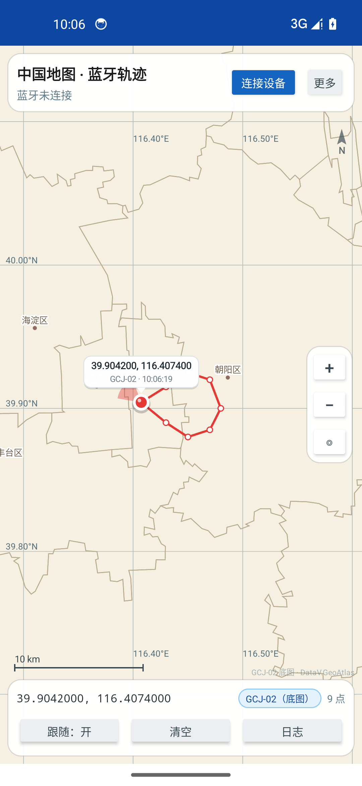
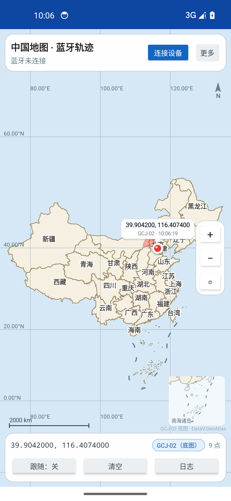
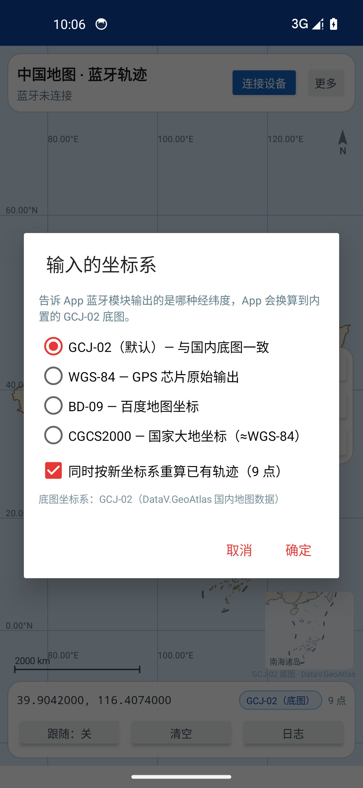
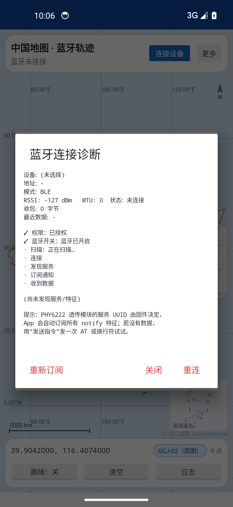
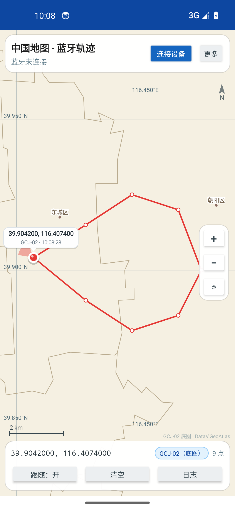

# 中国地图蓝牙轨迹（china-bt-map）

一个**完全离线**的 Android App：内置中国地图（GCJ-02），通过蓝牙 BLE / 经典 SPP 接收经纬度文本，
在地图上实时打点、连成轨迹；支持 WGS-84 / GCJ-02 / BD-09 / CGCS2000 四种输入坐标系。

- GitHub 仓库：<https://github.com/EmcMake/china-bt-map>
- 手机直接下载 APK（v1.1）：<https://github.com/EmcMake/china-bt-map/blob/main/dist/china-bt-map-1.1.apk>
- 安装包：`dist/china-bt-map-1.1.apk`（约 1.3 MB，已签名）
- 包名：`com.btmap.china`，最低 Android 7.0（API 24），targetSdk 34
- 纯 Java + Framework API，无 AndroidX / GMS / native 依赖；**没有 INTERNET 权限**

---

## 一、安装

把 `dist/china-bt-map-1.1.apk` 传到手机（微信/QQ、数据线、网盘均可），点击安装；
系统提示“未知来源”时允许一次即可。或用 adb：

```bash
adb install -r dist/china-bt-map-1.1.apk
```

> 自签名证书仅用于个人侧载，不能上架应用商店。升级请用同一个 `keystore/release.jks`
> （密码见下文“重新构建”），否则要先卸载旧版。

## 二、界面截图

| 主界面（城市级） | 全国视图 + 南海诸岛小图 |
| --- | --- |
|  |  |

| 输入坐标系 | 蓝牙连接诊断 |
| --- | --- |
|  |  |

最大缩放（约 10 米/像素）会提示数据精度上限：

## 三、坐标系（默认 GCJ-02）

| 选项 | 说明 |
| --- | --- |
| **GCJ-02（默认）** | 与内置底图一致；国内高德/腾讯等 App 通用 |
| WGS-84 | GPS 芯片原始输出；换算到 GCJ-02 后显示 |
| BD-09 | 百度地图坐标；先反算成 GCJ-02 |
| CGCS2000 | 国家大地坐标；与 WGS-84 差异 <10cm，按 WGS-84 处理 |

- 底部芯片显示当前选择（如 `WGS-84 → GCJ-02`），点它可以随时切换；
- 每个点都会记录自己的输入坐标系；切换默认只影响新点；
- 对话框里可勾选“同时按新坐标系重算已有轨迹”，用原始坐标重算，不丢数据；
- 旧版本设置自动迁移（不转换→GCJ-02，WGS84→GCJ-02→WGS-84）。

## 四、蓝牙（PHY6222 / BLE 透传模块）

丝印 `PH9Y 62220C` 推断为奉加微 **PHY6222**（BLE 5.2 SoC）。它**只有 BLE，没有经典 SPP**，
且**不定义应用层 UUID**——透传服务由模块固件决定（常见 0xFFE0/0xFFE1、0xFFF0/0xFFF1 或 128 位自定义）。

App 的做法：

1. 扫描 15 秒，列出名称 / MAC / RSSI，已配对与上次连接的设备置顶；记住上次设备，可自动连接；
2. `connectGatt` + 失败重试（status 133/257）、MTU 247、自动清 GATT 缓存；
3. 发现服务后**枚举全部特征**并自动订阅所有 NOTIFY/INDICATE（CCCD 串行写）；自动选择可写特征；
4. 需要加密时自动 `createBond`，绑定后重连重订阅；
5. 断开后按 2s/4s/8s 指数退避重连，并自动重新订阅；
6. **诊断页**（设备列表“诊断”或 更多 → 蓝牙诊断）显示：
   - 7 步状态：权限 / 蓝牙开关 / 扫描 / 连接 / 发现服务 / 订阅通知 / 收到数据；
   - 设备名称、MAC、RSSI、MTU、收字节数、最近数据；
   - 全部 Service/Characteristic UUID、属性、是否已订阅、各特征收字节；
   - 重连、重新订阅、发送指令（文本或 HEX，支持 `\r\n`）。

> 若模块固件要求先发握手/唤醒指令，用“发送指令”发一次（例如 `AT`、`\r\n`）即可；
> 仍连不上时，把诊断页内容发给开发者，按实际 UUID/固件补一轮适配。

## 五、坐标数据格式（一行一个点）

| 写法 | 示例 |
| --- | --- |
| 逗号 | `31.2304,121.4737` |
| 逗号 + 高度 | `31.2304,121.4737,12.5` |
| 空格 | `31.2304 121.4737 12.5` |
| 带键名 | `lat:31.2304 lon:121.4737` |
| JSON | `{"lat":31.2304,"lng":121.4737,"alt":8.5}` |
| 半球后缀 | `31.2304N,121.4737E` |
| NMEA | `$GPGGA,...` / `$GPRMC,...` / `$GPGLL,...`（GGA 的 HDOP 会换算成精度圈） |

纯数字默认按“纬度,经度”解析；第一个数超出 ±90 或明显更像经度时自动交换。
支持半包/粘包；`0,0`、越界坐标丢弃；0.5m 内重复点去重；轨迹上限 5 万点。

## 六、地图、缩放与精度

- 底图：DataV.GeoAtlas（34 个省级 + 475 个地级市/区县 + 南海九段线），**GCJ-02**，随 APK 内置；
- 数据格式 `CNMAP2`：坐标 int32 微度（0.1m），每要素带 bbox，存两套 LOD：
  - overview 约 8.7 万点（低缩放）
  - detail 约 18.7 万点（基本保留全部源顶点）
- 缩放：全国 0.6× ~ 约 **10 米/像素**；双指/双击/`+/−`/`◎`；到上限提示“数据精度上限”；
- 精度：底部坐标 **7 位小数**；经纬网自动细化到 0.005°；比例尺按中心纬度实时计算；
- 国内底图：全国尺度右下角有“南海诸岛”小图；底图标注 `GCJ-02 底图 · DataV.GeoAtlas`；
- 更多 → 地图显示：市界 / 地名 / 经纬网 / 精度圈 / 坐标气泡，五个开关，记忆设置。

## 七、定位红点

- 白环 + 红核 + 高光 + 阴影；收到新点时 1.8 秒脉冲；
- NMEA GGA 带 HDOP 时显示 **精度圈**（按米换算，随缩放变化）；
- 移动超过 3m 时显示**航向锥**；
- 两行标注：`39.904200, 116.407400` + `GCJ-02 · ±8m · 10:06:19`，自动避开顶部/底部控件；
- 标注点移出屏幕时，边缘显示 `↗ 1.2 km`，点它一键回中。

## 八、重新构建

工具链全部装在工程内 `toolchain/`，不污染系统：

```bash
./setup.sh --emulator   # JDK17 + Android SDK 34 + 模拟器镜像（一次性，约 2GB）
./build.sh              # aapt2 → javac → d8 → zipalign → apksigner
./tests/run_tests.sh    # 纯 JVM 单测（74 项）
./verify_emulator.sh    # 无窗口模拟器安装 + 注入坐标 + 截图（KEEP=1 保留模拟器）
python3 tools/pack_map.py   # 重新生成内置地图数据（CNMAP2）
```

- 版本号：`build.sh` 顶部 `VERSION_CODE` / `VERSION_NAME`；
- 签名：`keystore/release.jks`，alias `chinamap`，密码 `chinamap123`。

## 九、项目结构

```
app/src/main/
  AndroidManifest.xml               只有蓝牙权限，没有 INTERNET
  assets/china_map.bin              CNMAP2：微度坐标 + 双 LOD + bbox
  res/layout/activity_main.xml      地图 + 顶部状态 + 底部操作/坐标系芯片
  res/layout/dialog_devices.xml     设备列表 + 诊断入口
  res/layout/dialog_datum.xml       四种输入坐标系
  java/com/btmap/china/
    MainActivity.java               界面、权限、坐标系、诊断、演示/测试入口
    map/ChinaMapView.java           自绘地图：LOD/裁剪/缩放、红点、南海小图
    map/MapData.java                CNMAP2 解析
    map/Mercator.java               Web 墨卡托投影
    track/CoordSystems.java         四种坐标系 → GCJ-02
    track/CoordTransform.java       GCJ-02 / BD-09 / WGS-84 互转
    track/CoordParser.java          文本/JSON/NMEA 解析 + 精度
    track/TrackStore.java           原始坐标/坐标系/精度/重算
    bt/BtLink.java                  BLE 状态机、扫描、重试、订阅、诊断
tools/                              GeoJSON 抓取、CNMAP2 打包、图标
tests/CoreTest.java                 74 项 JVM 单测
docs/screenshots/                   模拟器实测截图
```

## 十、验证情况

- **74 项 JVM 单测**通过：坐标系映射/BD-09 往返/默认值/迁移、CNMAP2 精度、LOD、投影、
  比例尺、TrackStore 重算、解析器（半包、NMEA、精度、越界）等；
- Android 14 ARM64 模拟器：全新安装默认 GCJ-02、注入轨迹、全国视图、坐标系对话框、
  蓝牙诊断、最大缩放，均无崩溃；截图见上；
- APK 权限清单只有蓝牙相关项，**无 INTERNET**；
- 真机 PHY6222 链路需用你的模块实测：系统能扫到 → App 能扫到 → 连接 → 诊断页应显示服务 UUID、
  订阅数、收字节；若卡住，把诊断页截图/日志发来按固件补一轮。

## 十一、数据来源与合规

地图数据来自公开的 DataV.GeoAtlas，仅供个人学习/测试。面向公众发布的地图应用需使用具备
测绘资质的底图服务，本 App 的边界数据不适合作为正式对外产品发布。
